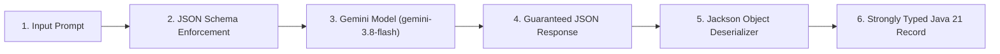

# Gemini API Structured Response Java Application

A production-ready Java 21 application demonstrating how to request and parse **Structured JSON Outputs** using the official Google Gen AI Java SDK (`com.google.genai:google-genai`).

Gemini models can be constrained to output responses conforming strictly to a specified JSON Schema. This application shows how to define schemas, make the API call, and deserialize the resulting JSON directly into strongly-typed Java Records using Jackson.

---

## 🌟 Key Features

1. **Official Google GenAI SDK Support**: Built on `com.google.genai:google-genai:1.80.0`.
2. **Dual Structured Output APIs**:
   - **Gemini Interactions API** (`client.interactions.create`): Uses JSON Schema maps with `TextResponseFormatMimeType.APPLICATION_JSON` (matches [Google's official structured output documentation](https://ai.google.dev/gemini-api/docs/structured-output#java)).
   - **Models GenerateContent API** (`client.models.generateContent`): Uses `GenerateContentConfig` with the SDK's built-in `com.google.genai.types.Schema` builder.
3. **Type-Safe Java 21 Records**: Automatic deserialization into immutable records (`Recipe`, `Ingredient`, `ModerationResult`, `MovieAnalysis`) using Jackson.
4. **Conditional Schemas (`anyOf`) & Enums**: Demonstrates dynamic polymorphic responses (e.g. spam detection with reasons vs. safe content with summaries).
5. **Real-Time Streaming**: Stream structured JSON chunks token-by-token using `EventStream<InteractionSSEStreamEvent>`.
6. **Execution Metrics & Cost Tracking**: Accurately tracks input tokens, output tokens, total tokens, latency in milliseconds/seconds, and calculates estimated USD cost based on official Gemini pricing.
7. **Graceful Simulation Mode**: If no `GEMINI_API_KEY` is provided, the application runs simulated mock runs so you can inspect schema formatting and object deserialization immediately.
8. **Zero-Friction Build**: Runs via `./run.sh`, Gradle (`./gradlew run`), or Maven (`mvn exec:java`).

---

## 📁 Project Structure

```
.
├── src
│   ├── main
│   │   └── java
│   │       └── com
│   │           └── example
│   │               └── gemini
│   │                   ├── Main.java                         # CLI and interactive menu
│   │                   ├── config
│   │                   │   └── GeminiClientFactory.java      # Client configuration & API key loader
│   │                   ├── model
│   │                   │   ├── ExecutionMetrics.java         # Token usage, latency & cost calculator
│   │                   │   ├── ExecutionResult.java          # Generic result wrapper with metrics
│   │                   │   ├── Ingredient.java               # Java 21 Record
│   │                   │   ├── Recipe.java                   # Java 21 Record
│   │                   │   ├── ModerationDecision.java       # Java 21 Record
│   │                   │   ├── ModerationResult.java         # Java 21 Record
│   │                   │   ├── MovieAnalysis.java            # Java 21 Record
│   │                   │   └── Sentiment.java                # Enum (POSITIVE, NEUTRAL, NEGATIVE)
│   │                   ├── service
│   │                   │   ├── RecipeExtractorService.java   # Interactions API extractor
│   │                   │   ├── ContentModerationService.java # anyOf / enum moderation
│   │                   │   ├── MovieAnalysisService.java     # GenerateContent API with Schema builder
│   │                   │   └── StreamingStructuredService.java # Streaming structured outputs
│   │                   └── util
│   │                       └── JsonMapperUtil.java           # Jackson configuration & helpers
│   └── test
│       └── java
│           └── com
│               └── example
│                   └── gemini
│                       ├── JsonMapperUtilTest.java           # Record parsing & sanitization tests
│                       ├── SchemaDefinitionTest.java         # Schema structure validation tests
│                       └── TestRunner.java                   # Standalone JUnit 5 test runner
├── lib/                                                      # Bundled offline dependencies
├── run.sh                                                    # Fast zero-setup launcher
├── test.sh                                                   # Fast test execution script
├── build.gradle                                              # Gradle build configuration
├── pom.xml                                                   # Maven build configuration
├── .env.example                                              # Environment variable template
└── README.md
```

---

## 🏃 Step-by-Step Run Process

### Step 1: Verify Java Version
Ensure Java 21 or higher is installed and configured:
```bash
java -version
```
*(On macOS with Homebrew, if not set automatically, you can run: `export JAVA_HOME="/opt/homebrew/opt/openjdk@21"`)*

---

### Step 2: Configure Your API Key
The application looks for the API key in the following priority order:
1. `GEMINI_API_KEY` environment variable
2. `GOOGLE_API_KEY` environment variable
3. System property `-Dgemini.api.key=...`
4. Local `.env` file in the project root

**Option A: Local `.env` file (Recommended for development)**
Create a file named `.env` in the project root:
```properties
GEMINI_API_KEY=your_actual_api_key_here
```
*(Note: `.env` is already included in `.gitignore` so your key won't be committed).*

**Option B: Terminal Environment Variable**
```bash
export GEMINI_API_KEY="your_actual_api_key_here"
```

> **Simulation / Demo Mode**: If no API key is provided, the application will automatically run in Simulation Mode using genuine sample model responses so you can inspect schema formatting and object mapping without an active key.

---

### Step 3: Run the Application

#### Method 1: Instant Run Script (`./run.sh`)
This script uses the pre-bundled dependencies in `lib/` and compiles/runs immediately with zero build tool overhead:

1. **Interactive Mode**:
   ```bash
   ./run.sh
   ```
   This opens an interactive menu where you can choose which structured demo to run (1 to 6).

2. **Direct CLI Execution**:
   Run any specific demo directly by name:
   ```bash
   # Demo 1: Recipe Extraction (Interactions API)
   ./run.sh recipe

   # Demo 2: Content Moderation (anyOf conditional schema & enum)
   ./run.sh moderate

   # Demo 3: Movie Analysis (client.models.generateContent + Schema builder)
   ./run.sh movie

   # Demo 4: Real-time Token Streaming
   ./run.sh stream

   # Run All Demos in sequence
   ./run.sh all
   ```

3. **Custom Input Extraction**:
   Pass your own custom text to any command:
   ```bash
   ./run.sh recipe "To make banana bread, mash 3 ripe bananas, mix with 1/3 cup melted butter, 1 tsp baking soda, pinch of salt, 3/4 cup sugar, 1 beaten egg, 1 tsp vanilla, and 1 1/2 cups all-purpose flour. Bake at 350°F (175°C) for 50-60 minutes."
   ```
   ```bash
   ./run.sh moderate "Urgent! Your account has been suspended. Click here to verify: http://fake-login-security.net"
   ```

---

#### Method 2: Running with Gradle
```bash
# Interactive mode
./gradlew run --console=plain

# Pass CLI arguments to run specific demos
./gradlew run --args="recipe"
./gradlew run --args="moderate"
./gradlew run --args="movie"
./gradlew run --args="all"
```

---

#### Method 3: Running with Maven
```bash
# Compile and run default interactive mode
mvn clean compile exec:java

# Run a specific demo
mvn exec:java -Dexec.args="movie"
mvn exec:java -Dexec.args="all"
```

---

### Step 4: Run Unit Tests
To verify all JSON schemas and Jackson Record deserializers:
```bash
# Standalone test runner (instant)
./test.sh

# Or with Gradle
./gradlew test

# Or with Maven
mvn test
```

### Step 5: Token Usage, Latency & Cost Metrics
At the conclusion of every Gemini structured response, the application prints a breakdown:
```text
⏱️  Gemini Execution Metrics:
  • Input Tokens:     142
  • Output Tokens:    103
  • Total Tokens:     245
  • Time Taken:       1,450 ms (1.45 s)
  • Estimated Cost:   $0.000055 USD
```

---

### 🔍 What Happens During Execution



1. **Client Initialization**: `GeminiClientFactory` reads your `GEMINI_API_KEY` and initializes `com.google.genai.Client`.
2. **Schema Definition**: The service builds a JSON Schema defining property names, types (`string`, `integer`, `array`, `object`), constraints (`enum`, `required`), and descriptions.
3. **API Request**: The SDK transmits the request with `responseFormat(mimeType: "application/json", schema: ...)` to `gemini-3.8-flash`.
4. **Constrained Decoding**: The Gemini backend constrains the output tokens to match the schema strictly.
5. **Type-Safe Mapping**: Jackson parses the raw JSON string directly into Java Records (`Recipe`, `ModerationResult`, `MovieAnalysis`), giving you compile-time type safety and accessor methods.

---

## 💡 Code Examples

### 1. Interactions API (Recipe Extraction)
This pattern uses `CreateModelInteraction` and a JSON Schema `Map`:

```java
import com.google.genai.Client;
import com.google.genai.gaos.models.interactions.*;
import com.google.genai.gaos.models.operations.CreateInteractionRequestBody;

Client client = Client.builder().apiKey(apiKey).build();

// Define JSON Schema
Map<String, Object> schema = new HashMap<>();
schema.put("type", "object");
schema.put("properties", Map.of(
    "recipe_name", Map.of("type", "string", "description", "The recipe name"),
    "prep_time_minutes", Map.of("type", "integer"),
    "ingredients", Map.of(
        "type", "array",
        "items", Map.of(
            "type", "object",
            "properties", Map.of(
                "name", Map.of("type", "string"),
                "quantity", Map.of("type", "string")
            ),
            "required", List.of("name", "quantity")
        )
    ),
    "instructions", Map.of("type", "array", "items", Map.of("type", "string"))
));
schema.put("required", List.of("recipe_name", "ingredients", "instructions"));

// Set response format to application/json with schema
CreateModelInteractionResponseFormat format =
    CreateModelInteractionResponseFormat.of(
        ResponseFormat.of(
            TextResponseFormat.builder()
                .mimeType(TextResponseFormatMimeType.APPLICATION_JSON)
                .schema(schema)
                .build()));

CreateModelInteraction params = CreateModelInteraction.builder()
    .model(Model.of("gemini-3.8-flash"))
    .input(InteractionsInput.of("Extract the recipe from: " + text))
    .responseFormat(format)
    .build();

Interaction interaction = client.interactions.create(
    CreateInteractionRequestBody.of(params)
).interaction().get();

// Output is guaranteed to follow the schema
String rawJson = interaction.outputText().orElse("{}");
Recipe recipe = JsonMapperUtil.fromJson(rawJson, Recipe.class);
```

### 2. GenerateContent API (`com.google.genai.types.Schema`)
This pattern uses `GenerateContentConfig` with the SDK's `Schema.builder()`:

```java
import com.google.genai.Client;
import com.google.genai.types.GenerateContentConfig;
import com.google.genai.types.GenerateContentResponse;
import com.google.genai.types.Schema;

Schema schema = Schema.builder()
    .type("OBJECT")
    .properties(Map.of(
        "title", Schema.builder().type("STRING").description("Film title").build(),
        "release_year", Schema.builder().type("INTEGER").build(),
        "sentiment", Schema.builder().type("STRING").enum_(List.of("POSITIVE", "NEUTRAL", "NEGATIVE")).build(),
        "rating_out_of_10", Schema.builder().type("NUMBER").build(),
        "key_themes", Schema.builder().type("ARRAY").items(Schema.builder().type("STRING").build()).build(),
        "summary", Schema.builder().type("STRING").build()
    ))
    .required(List.of("title", "sentiment", "summary"))
    .build();

GenerateContentConfig config = GenerateContentConfig.builder()
    .responseMimeType("application/json")
    .responseSchema(schema)
    .temperature(0.2f)
    .build();

GenerateContentResponse response = client.models.generateContent(
    "gemini-3.8-flash",
    "Analyze this review: " + reviewText,
    config
);

MovieAnalysis analysis = JsonMapperUtil.fromJson(response.text(), MovieAnalysis.class);
```

### 3. Mapping to Strongly-Typed Java Records
Jackson automatically binds the JSON keys to Record components:

```java
public record Recipe(
    @JsonProperty(value = "recipe_name", required = true)
    String recipeName,

    @JsonProperty("prep_time_minutes")
    Integer prepTimeMinutes,

    @JsonProperty(value = "ingredients", required = true)
    List<Ingredient> ingredients,

    @JsonProperty(value = "instructions", required = true)
    List<String> instructions
) {}

public record Ingredient(
    @JsonProperty("name") String name,
    @JsonProperty("quantity") String quantity
) {}
```

---

## ⚙ Supported Schema Features in Gemini

- **Types**: `string`, `number`, `integer`, `boolean`, `object`, `array`, `null`
- **Classifications**: `enum` with predefined constant strings
- **Conditionals**: `anyOf` to return one of multiple distinct object shapes
- **Descriptions**: `description` to provide context to the model for each field
- **Guaranteed Output**: Responses are syntactically valid JSON adhering to the specified schema

---

## 📄 License
Apache License 2.0

